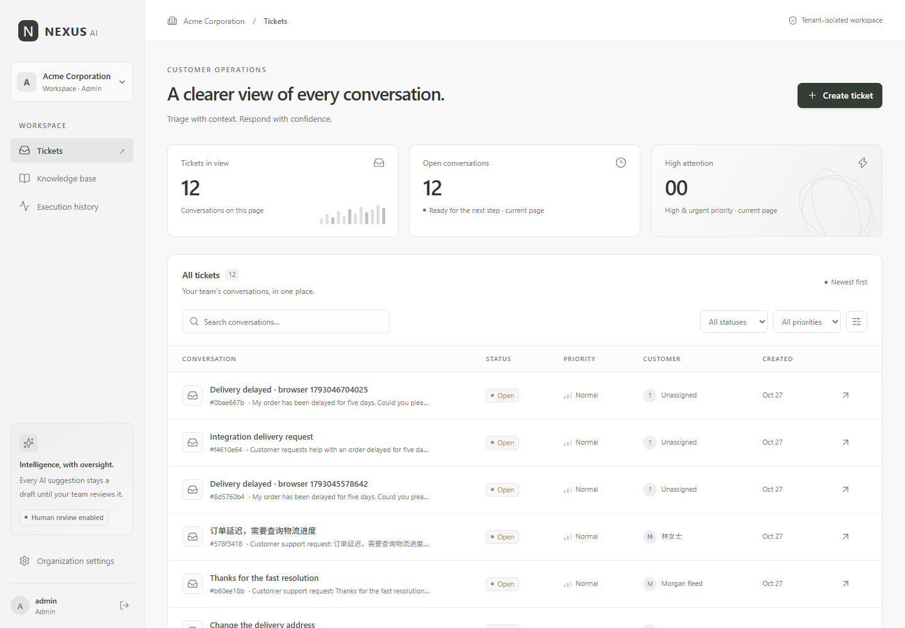
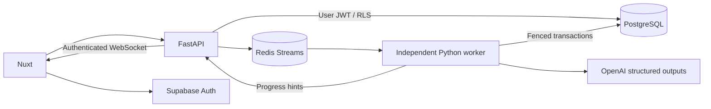

# NEXUS AI

**Turn customer conversations into clear, reviewable next steps.**

A multi-tenant ticket intelligence engine built with Nuxt, FastAPI, Supabase PostgreSQL/Auth and Redis Streams. Analyze a ticket asynchronously, retrieve organization-specific knowledge, inspect structured results and approve a response draft. Every recommendation remains under human control.

[](https://github.com/ziyis-studio/nexus-ai/actions/workflows/ci.yml)



[Watch the recorded local walkthrough](docs/demo/product-walkthrough.webm) · [AI workspace](docs/screenshots/analysis.png) · [Knowledge library](docs/screenshots/knowledge.png) · [Mobile view](docs/screenshots/mobile.png)

## What you can do

- Work across authorized organizations with Admin, Agent and Viewer roles.
- Create, search, filter, edit and progress support tickets through their lifecycle.
- Queue analysis without blocking a long HTTP request; follow live progress and durable execution history.
- Review category, sentiment, suggested priority, summary, draft and verified knowledge references.
- Approve or reject once, with actor/time and an audit trail. Approval never sends a message.
- Maintain active/archived knowledge and inspect organization membership and audit history.

The approved [PRD](docs/PRD.md) defines P0. Semantic search, invitations, billing and external delivery remain future scope.

## Try the portable preview

Requirements: **Node 24.22.1**, **Python 3.12.14**, **uv** and Git.

```sh
npm ci
uv sync --frozen
npm run sandbox
```

Open `http://127.0.0.1:3000`. Use `admin@nexus.test`, `agent@nexus.test` or `viewer@nexus.test` with password `Nexus-demo-2026!`. Admin can switch between Acme and Nova; the other roles demonstrate access limited to Acme. Ctrl+C stops the preview.

The portable preview runs **real native PostgreSQL and PostgREST**, with **synthetic auth, a Redis test double and a deterministic model fixture**. It is a local review environment; keep it on loopback and use synthetic records. It does not require or demonstrate real OpenAI inference. The full CI also exercises real Redis and real local Supabase Auth separately.

## Run with Supabase and a real model

Start the Supabase local stack with `npx supabase start`, copy `.env.example` to `.env`, configure your project and server-side OpenAI key, provision synthetic demo accounts with `uv run python scripts/seed.py`, then run `docker compose up --build -d`. For container-to-host database/Auth addresses and secure hosted configuration, follow [DEPLOYMENT.md](docs/DEPLOYMENT.md).

Supabase service-role, database and model credentials stay server-side. Browser configuration contains only the public project key and public API/Auth URLs.

## How reliability works



PostgreSQL is authoritative. A committed queued run survives an enqueue outage. Workers use atomic claims, expiring leases and token-fenced writes. Reconciliation republishes unfinished work; terminal state and results commit together before acknowledgment. Idempotency keys and database uniqueness prevent duplicate executions/results. User queries always carry the end user's verified identity through RLS.

## Verify

```sh
uv run pytest --cov=app.services --cov=app.schemas --cov=app.repositories --cov=services.worker.ai --cov=services.worker.main --cov-fail-under=80
node scripts/test-database.mjs
npm run typecheck
npm run build
npm run test:e2e
```

Browser tests need the running test environment and Chromium (`npx playwright install chromium`). Native PostgreSQL, integration, real local Supabase, pgTAP, contract, formatting and performance commands are documented in [TEST_PLAN.md](docs/TEST_PLAN.md). CI also builds both Docker images.

## Engineering documents

| Document                                                  | Content                                                        |
| --------------------------------------------------------- | -------------------------------------------------------------- |
| [PRD](docs/PRD.md)                                        | Original requirements, preserved                               |
| [SDD](docs/SDD.md)                                        | Boundaries, transactions, quotas, retries and recovery         |
| [Architecture](docs/ARCHITECTURE.md) / [ERD](docs/ERD.md) | Component and data relationships                               |
| [Security](docs/SECURITY.md)                              | JWT/session/RBAC/RLS design and privileged helper review       |
| [API](docs/API.md) / [OpenAPI](contracts/openapi.yaml)    | Typed REST contract and error semantics                        |
| [WebSocket protocol](docs/websocket-protocol.md)          | Authentication, events and reconciliation                      |
| [Test plan](docs/TEST_PLAN.md)                            | Reproducible checks and evidence boundaries                    |
| [Performance](docs/PERFORMANCE.md)                        | Actual 10,000-ticket query measurements and limitations        |
| [Deployment](docs/DEPLOYMENT.md)                          | Local, Docker, hosted staging, backup and recovery             |
| [Release status](docs/RELEASE_STATUS.md)                  | Confirmed verification, CI state and outstanding staging gates |

## Delivery status

P0 source and runnable review environment are implemented. Production acceptance remains conditional on CI/Supabase staging verification, a real configured OpenAI call and review of the documented upstream development-tooling advisory. No hosted production deployment or live-account model inference is implied by fixture tests. See the release status for the precise evidence.
