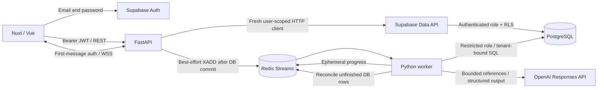

# Architecture

NEXUS AI is a modular monolith with an independent worker. Nuxt is a client-rendered interface; FastAPI owns the application API. Supabase owns identity and PostgreSQL. Redis transports work and ephemeral progress, while PostgreSQL owns durable execution state.

The API never uses a Supabase service key for user business queries. Every request gets a separate HTTPX client with the caller's verified JWT and the public project key. Membership is loaded from PostgreSQL rather than JWT metadata. The privileged provisioning key appears only in the explicit seed script.

See [SDD](SDD.md) for transaction and recovery details, [ERD](ERD.md) for relationships, and [SECURITY](SECURITY.md) for the privileged function review.
