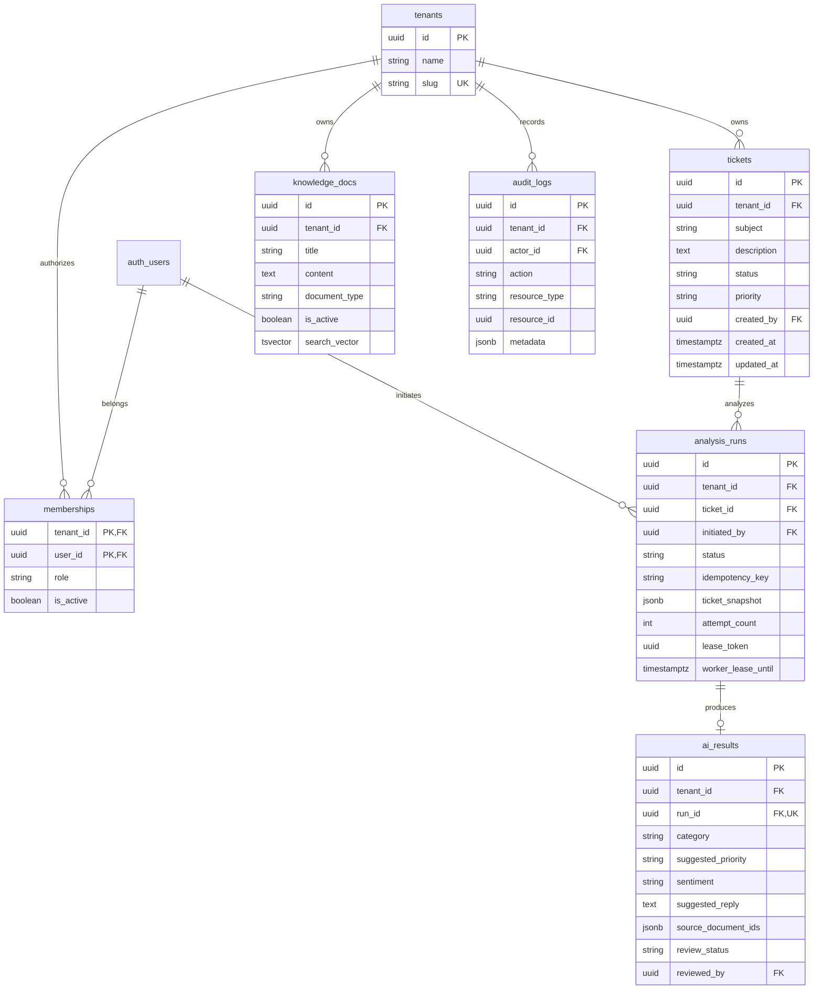

# Entity relationships

Tenant-consistent composite foreign keys connect `(tenant_id, ticket_id)` and `(tenant_id, run_id)`. A unique `run_id` permits one result per execution. `(tenant_id, initiated_by, idempotency_key)` protects duplicate submissions. Source-document IDs are additionally checked by a tenant/active-document trigger and the worker's retrieved-document allowlist.

There are no business-data DELETE grants or API endpoints in P0. Archived knowledge remains readable for historical citations. Audit records contain identifiers and safe event metadata, never ticket text or credentials.
